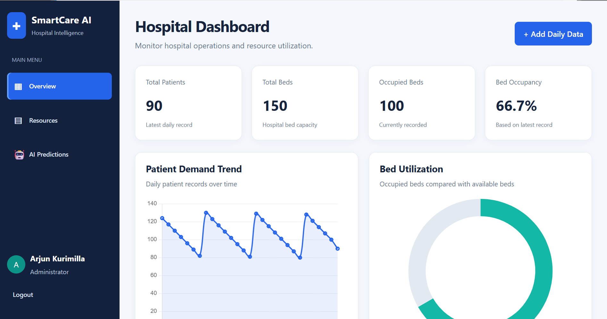
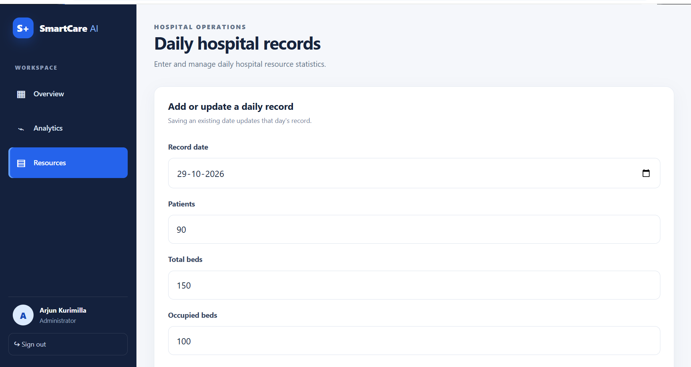
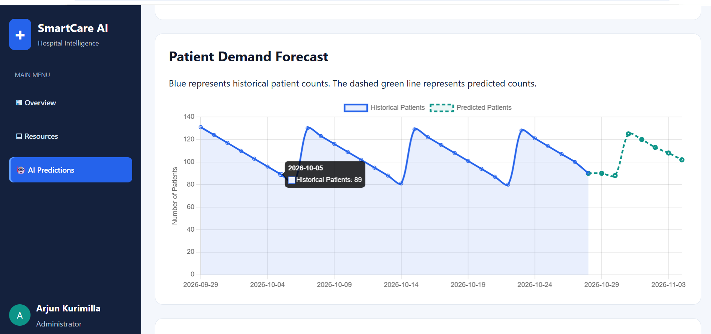
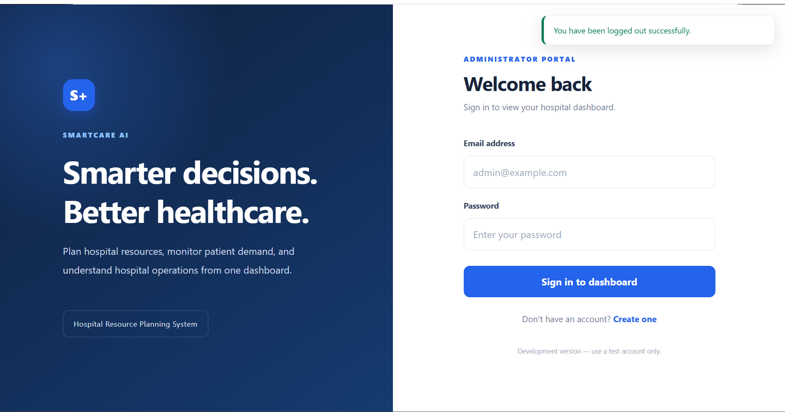

# SmartCare AI – Hospital Resource Planning System

## About the Project

SmartCare AI is a web-based project developed to explore how machine learning can be used for hospital resource planning. It allows users to enter daily hospital records, view statistics on a dashboard, forecast patient demand for the next seven days, and see basic recommendations about hospital resources.

I built this project using Python and Flask, with SQLite for storing records and Scikit-learn for the forecasting model.

## Features

- User registration and login
- Daily hospital resource record management
- Dashboard with patient and resource statistics
- Charts for viewing hospital data
- Seven-day patient demand forecasting
- Model evaluation using MAE, RMSE, and R²
- Comparison of Random Forest with a seasonal baseline
- Basic recommendations for bed capacity and doctor availability

## Application Screenshots

### 1. Dashboard



The dashboard provides an overview of the recorded hospital statistics and charts.

### 2. Hospital Resources



This page is used to enter daily patient counts, bed details, and doctor availability.

### 3. AI Predictions



This page displays historical patient data and the seven-day patient demand forecast.

### 4. Model Evaluation


This section displays the forecasting model's evaluation metrics and compares them with a seasonal baseline.

### 5. Login Page



The login page allows registered users to access the application.

## Technologies Used

| Technology | Purpose |
|---|---|
| Python | Application logic and prediction code |
| Flask | Web application framework |
| SQLite | Database for storing records |
| Flask-SQLAlchemy | Database operations |
| Flask-Login | User authentication |
| Pandas | Data processing |
| Scikit-learn | Machine learning and model evaluation |
| HTML | Page structure |
| CSS | Page styling and responsive layout |
| JavaScript | Dashboard interactions |
| Chart.js | Charts and visualizations |

## How the Project Works

1. A user registers and logs in.
2. Daily hospital statistics are entered through the Resources page.
3. The application stores the records in SQLite.
4. The dashboard displays the available hospital statistics.
5. The prediction module processes historical patient counts and generates a seven-day forecast.
6. The model is evaluated using MAE, RMSE, and R² where applicable.
7. The results and preliminary resource recommendations are displayed on the prediction page.

## Machine Learning Approach

The project uses **Random Forest Regression** to forecast patient demand.

The model uses features such as:

- Day number
- Day of the week
- Previous day's patient count
- Patient count from seven days earlier
- Seven-day rolling average

The model's predictions are compared with a seasonal baseline that uses patient counts from the previous week.

MAE and RMSE measure prediction errors, while R² indicates how well the model explains variation in the test data when the metric is applicable.

In my current testing, the seasonal baseline performs better than Random Forest on the available test records. This shows that the model needs further improvement and testing.

## Project Structure

```text
SMART CARE AI/
├── app.py
├── models.py
├── predictions.py
├── requirements.txt
├── README.md
├── .gitignore
├── instance/
│   └── smartcare.db
├── screenshots/
│   ├── dashboard.png
│   ├── login.png
│   ├── model-evaluation.png
│   ├── predictions.png
│   └── resources.png
├── static/
│   ├── css/
│   │   └── style.css
│   └── js/
│       └── dashboard.js
└── templates/
    ├── base.html
    ├── login.html
    ├── register.html
    ├── dashboard.html
    ├── resources.html
    └── prediction.html
```

## Installation and Setup

### Requirements

- Python 3
- pip
- A code editor such as Visual Studio Code

### 1. Clone the repository

Replace the placeholder with your actual GitHub repository URL.

```bash
git clone YOUR_GITHUB_REPOSITORY_URL
cd "SMART CARE AI"
```

Alternatively, open the project folder directly in VS Code if you already have it on your computer.

### 2. Create a virtual environment

On Windows PowerShell, run:

```powershell
python -m venv .venv
.\.venv\Scripts\Activate.ps1
```

### 3. Install dependencies

```powershell
python -m pip install -r requirements.txt
```

### 4. Run the application

```powershell
python app.py
```

Open the following address in your browser:

`http://127.0.0.1:5000`

Register an account and log in to explore the application.

**Note:** The forecasting module requires at least 14 consecutive daily records. If there are missing dates, the application asks for the records to be corrected before forecasting.

## Testing Checklist

- [ ] Register a new account and log in.
- [ ] Add daily hospital resource records.
- [ ] Verify that the dashboard displays the recorded data.
- [ ] Open the AI Predictions page.
- [ ] Check the seven-day forecast and evaluation metrics.
- [ ] Review the resource recommendations.
- [ ] Verify that logout works.

## Limitations

- The current dataset contains generated demonstration records.
- The forecasting model is experimental and requires more data and testing.
- The seasonal baseline currently performs better on the available test records.
- Resource recommendations use basic rules and are not a substitute for professional hospital planning.

The application is an academic demonstration and should not be used to make actual clinical or hospital operational decisions.

## Future Improvements

- Test the model with larger and more representative datasets.
- Improve forecasting accuracy through further experimentation.
- Add automated tests and stronger input validation.
- Improve resource planning and reporting.
- Add role-based access for different hospital staff.

## What I Learned

While developing this project, I gained practical experience with Flask, database integration, user authentication, data processing, machine learning, model evaluation, and interactive charts. I also learned the importance of comparing a machine learning model with a simple baseline before deciding whether it performs well.
